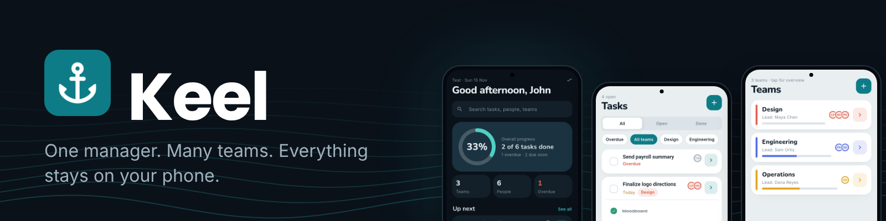
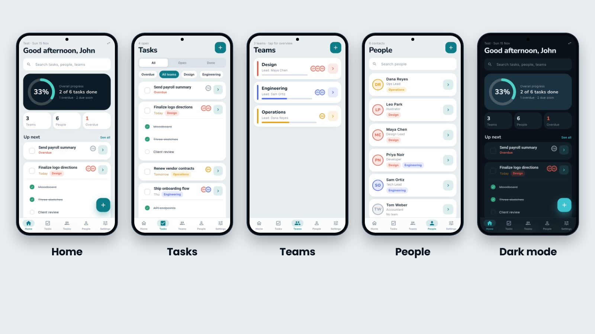

<p align="center">
  
</p>

# Keel

A calm, offline task manager for anyone who leads more than one team.

**Website:** https://abybijo.github.io/Keel/

- Teams with one leader and one main task
- Tasks with sub-tasks, due dates and priorities
- People with phones, emails, photos and notes
- Calendar with due dates, dots and day notes
- Multiple organizations, all on-device
- No account, no server, no internet
- Backup and restore from a file you control



## Who it's for

A manager, coach, team lead or organizer keeping track of people,
teams and tasks in one place — and anyone who wants their notes,
contacts and plans to stay private by design, not by a privacy
policy.

## What you can do

- **Teams** — create teams with a leader, members and a main task,
  and see each team's progress at a glance. Teams and People share
  one tab, with Teams | People sub-tabs.
- **People** — keep every person's phones, emails, role and notes;
  call, email or message (WhatsApp) straight from their card.
- **Tasks** — tasks with due dates, priorities, sub-todos and
  assignees. A task can belong to a team, to people, to both, or
  stand alone.
- **Calendar** — a month view of your task due dates. Dots mark days
  with open tasks, red when overdue. Tap a day to see its tasks, add
  one due that day, or keep a note for the day.
- **Sub-todos** — break a task into steps. Finishing the last step
  offers to complete the task; reopening a step reopens it.
- **Today, at a glance** — a progress dial, an Up next list and an
  overdue count on Home, plus a daily reminder digest and per-task
  reminders if you switch them on.
- **Backup** — export everything to a file you control, and restore
  it later. Your data, your file.
- **Sample data** — try it with a ready-made demo organization
  (Northwind Studio) from Settings, or start empty.
- **Made yours** — dark mode, text size, accent colour, haptics and
  week start, all in Settings → Personalisation.

## The complete feature details

- **Organizations** — run one organization or several; switch
  between them from the Home header. First launch is a 2-step
  setup, never shown again.
- **Teams** — create a team with a leader (who must be a member),
  members, a colour and at most one main task. Each team shows its
  progress (done tasks out of all its tasks) at a glance. Teams and
  People share one tab, with Teams | People sub-tabs above the
  bottom bar (default Teams).
- **People** — every person keeps unlimited phone numbers and email
  addresses, a role, notes and a photo. Call, email or message
  (WhatsApp) straight from their card. Live search across name,
  role, phone, email and team.
- **Tasks** — due dates, priorities, notes, sub-todos and assignees.
  A task can belong to a team, to people, to both, or stand alone.
  Filter by All / Open / Done, by team or person, or show overdue
  only. Swipe to delete or complete.
- **Calendar** — a month view of task due dates. Dots mark days with
  open tasks, red when overdue. Tap a day to see its tasks, add one
  due that day, or keep a note for the day. Week rows follow Week
  Starts On. A task ticked done stays on its day, under the open
  tasks, shown as done, and clears after about a day.
- **Sub-todos** — break a task into steps. Finishing the last step
  offers to complete the task; reopening a step reopens it.
- **Overview sheets** — tap a task, team or person tile (anywhere
  except the arrow) and a quick sheet slides up: the task sheet has
  the checkbox, due date, notes, sub-todo checklist, assignees, a
  button to its team, and Complete / Edit / Delete (with Undo); the
  person sheet has **Call** on the right with **Message** (WhatsApp)
  directly below it; the team sheet has stats, main task and
  members. Tap the arrow and the full page opens.
- **Home, at a glance** — a greeting that follows the time of day, a
  progress dial, stat tiles, an Up next list, team cards and global
  search. The floating Add button opens Task, Person or Team.
- **Undo, everywhere it matters** — deleting a task, person or team
  shows a 6-second Undo. Deleting a team keeps its people and tasks;
  deleting a person removes only their assignments and memberships.
- **Reminders** — a daily digest of due and overdue tasks at a time
  you choose, plus a reminder for each task on its due date and when
  it goes overdue.
- **Backup** — export everything to a file you control and restore
  it later, through the Android file picker. Tasks can also be
  exported as CSV.
- **Sample data** — try it with a ready-made demo organization
  (Northwind Studio) from Settings, or start empty.
- **Made yours** — dark mode, text size, accent colour, haptics and
  week start, all in Settings → Personalisation.

## Personalisation

- **Text size** — a slider with four locked stops: Small, Medium,
  Large, Extra Large.
- **Haptics** — on/off toggle. When off, every haptic in the app is
  silent. A Test vibration button lets you feel the strength you
  picked.
- **Vibration Intensity** — Light, Medium or Heavy (default Medium).
  Tap an intensity to feel it before you pick it; when Haptics is
  off the control stays visible but greyed out and untouchable.
- **Week starts on** — Monday, Saturday or Sunday (default Monday).
- **Accent colour, theme** (light / dark / system) and **reduce
  motion**.

## Download

Get the latest release here: [Keel releases](https://github.com/AbyBijo/Keel/releases/latest)

See the website for screenshots and the full story: https://abybijo.github.io/Keel/

- **Most modern Android phones:** [app-arm64-v8a-release.apk](https://github.com/AbyBijo/Keel/releases/latest/download/app-arm64-v8a-release.apk)
- **Older 32-bit phones:** [app-armeabi-v7a-release.apk](https://github.com/AbyBijo/Keel/releases/latest/download/app-armeabi-v7a-release.apk)
- **x86_64 devices (mostly emulators):** [app-x86_64-release.apk](https://github.com/AbyBijo/Keel/releases/latest/download/app-x86_64-release.apk)

The debug build (`app-debug.apk`) is on the same release page. Sizes vary with each version — GitHub shows the size next to every file.

If you had the earlier build under the old package name
(`com.abybijo.keel`), uninstall it first: 1.2.0 is
`com.keel.manager` and installs as a separate app, and data does
not carry over.

## Privacy

- **No `INTERNET` permission.** The app cannot reach the network
  at all.
- **No analytics, no trackers, no account, no ads.**
- Photos are copied into the app's private storage; the database
  stores only the path.
- Backup files are created only when you export them, through the
  Android system file picker.

## For developers

Keel is built with Flutter (Dart) + Drift (SQLite) and Riverpod.
No server, no network. To run it:

```sh
flutter pub get
flutter analyze
flutter test
flutter run
```

Debug APKs are also built by CI as the `keel-debug-apk` artifact
(~77.3 MB). The security review and known gaps live in
`docs/security.md` and `docs/risks.md`.

Keel is designed and developed by **Aby Bijo** —
[GitHub](https://github.com/AbyBijo) ·
[LinkedIn](https://www.linkedin.com/in/aby-bijo-102359282) ·
[Buy Me a Coffee](https://www.buymeacoffee.com/AbyBijo).

## License

Keel is open source under the [Apache License 2.0](LICENSE).
